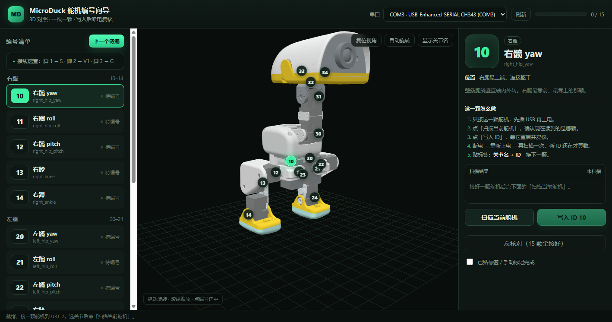

# MicroDuck 舵机编号向导（3D）

飞特 HD-1910 / SCS 总线的舵机编号小工具：左边 15 个 ID 清单，中间 3D 鸭子标出每个关节，右边选中关节后直接**扫描 / 写入 / 复核**。一次只接一颗，写完断电重启复核，贴「关节名 + ID」。

> 非官方社区工具，与 Pollen Robotics 无隶属关系。
> 3D 模型是 Microduck 上游模型的衍生作品，**CC BY-NC-SA 4.0（非商业）**；代码 MIT；详见 [NOTICE.md](NOTICE.md) 和 [LICENSE](LICENSE)。



## 它解决什么问题

15 颗舵机长得一模一样，编号写进舵机里之后，光看外观分不出谁是谁。这个工具把「编号」和「3D 里的关节位置」对上：

- 选一个关节（比如 10 右髋 yaw）→ 3D 里对应位置闪烁 → 把手里的舵机写成 10 → 贴标签。
- 下次装配时按标签找关节，不用再猜。

## 能做什么

- **3D 对照**：主仓 `model.json` / `meshes.bin`，浏览器自带 WebGL2 渲染，不依赖 CDN，断网可用。
- **扫描**：自动试 1M / 500k / 250k / 128k / 115200 等波特率，读 ID、型号、位置、电压、温度、保护位。
- **写入**：解锁 EEPROM → 写 ID → 加锁 → 0x08 重启 → ping 新 ID、回读寄存器 → 确认旧 ID 消失。
- **保护**：默认把卸载条件 19 的过压（bit0）和过流（bit3）打开；不动波特率、模式、PID、中位。
- **台账**：每次改号追加到 `servo_ledger.jsonl`；页面进度 0/15，支持手动补记。
- **总核对**：15 颗全接好后跑 `verify`，列出缺的 / 多的。
- **无硬件演示**：`--fake` 起一颗模拟舵机，完整走一遍扫描和改号。

## 硬件 / 软件要求

| 项 | 要求 |
|---|---|
| 舵机 | 飞特 HD-1910（SCS/STS 协议，1 Mbps，出厂 ID=1）；其他飞特 SCS 舵机理论兼容，未实测 |
| 调试板 | FE-URT-2（CH343，Win10/11 免驱）或同芯片的 USB 转半双工板 |
| 接线 | 舵机脚 1 Signal → URT-2 `S`；脚 2 Vcc → `V1`；脚 3 GND → `G` |
| 电脑 | Windows / Linux / macOS |
| Python | 3.10+（3.11 实测），需要 `pyserial` |
| 浏览器 | Chrome / Edge，支持 WebGL2 |

**只配 ID 用 USB 5 V 就够**，不要往 V1 灌 7.4 V。

## 快速开始

### Windows

1. 安装 Python 3.11+（勾选 Add Python to PATH）。
2. 在本目录打开 PowerShell：

   ```powershell
   pip install -r requirements.txt
   ```

3. 双击 `web\启动编号向导.bat`，或：

   ```powershell
   python web\server.py --open
   ```

4. 浏览器打开 `http://127.0.0.1:8090/`。

### Linux / macOS

```bash
pip3 install -r requirements.txt
python3 web/server.py --open
```

或者：

```bash
chmod +x start.sh
./start.sh
```

### 没接硬件，先看效果

```bash
python web/server.py --fake --open
```

模拟总线上有一颗 ID=1 的虚拟舵机；扫描、写入、进度都会动，**不会碰真硬件**。

## 接线

```
舵机线                     URT-2（白色 TTL-Bus 口，丝印 G V1 S）
脚 1 Signal / TTL   →     S
脚 2 Vcc            →     V1（蓝色端子）
脚 3 GND            →     G（蓝色端子）
```

- **中间那根一定是 V**；认脚号，别认颜色。
- S/G 接反不会烧，只是搜不到，对调即可。
- **先插 URT-2 的 USB，再给舵机上电。** 反了总线可能被压在 2.1 V，一颗都不应答。
- URT-2 的拨码是 TTL 信号电平（3.3 / 5 V），拨 5 V 侧。
- **一次只接一颗舵机。** 改 ID 时总线上有多颗会一起改，工具会直接拒绝。

## 使用流程

1. 打开页面，顶栏选串口（通常只有一个 CH343）。
2. 左侧点「下一个待编」，或直接点某个关节。
3. 只接这一颗舵机，点「扫描当前舵机」。
4. 确认当前 ID → 点「写入 ID」→ 断电 → 重新上电 → 再扫描确认。
5. 贴标签，点「下一个待编」。

推荐顺序：**10 → 11 → 12 → 13 → 14 → 20 → 21 → 22 → 23 → 24 → 30 → 31 → 32 → 33 → 34**。

## ID 表

| ID | 关节 | ID | 关节 | ID | 关节 |
|---|---|---|---|---|---|
| **10** | 右髋 yaw | **20** | 左髋 yaw | **30** | 颈俯仰 |
| **11** | 右髋 roll | **21** | 左髋 roll | **31** | 头俯仰 |
| **12** | 右髋 pitch | **22** | 左髋 pitch | **32** | 头 yaw |
| **13** | 右膝 | **23** | 左膝 | **33** | 头 roll |
| **14** | 右踝 | **24** | 左踝 | **34** | 嘴 |

十位 = 部位（1 右腿 / 2 左腿 / 3 颈头），个位 = 从躯干往末端数（0 髋 yaw → 4 踝）。
`200` 是 `imu_to_dxl` 板，固件写死，不要配给舵机。

> 第一台机器历史上嘴用过 29（原 34 挪作 21 后的临时值）。新复刻按设计表用 **34**。

## 命令行

不想开网页时：

```bash
python servo_numbering.py ports
python servo_numbering.py scan
python servo_numbering.py assign --to 10 --joint 右髋yaw
python servo_numbering.py verify
python servo_numbering.py doctor
python servo_numbering.py labels
python servo_numbering.py wizard
```

- `assign` 默认打开过压/过流；加 `--no-protect` 关掉。
- `--mouth-id 29` 可把嘴改成 29；`--mouth-id 0` 不编嘴。
- `wizard` 是交互式，一颗一颗带着做。

## 安全提醒

- **改 ID / 开保护会写 EEPROM**，是真实硬件操作。确认接线、供电、只接一颗再点。
- 不要把本服务暴露到公网。它只监听 `127.0.0.1`，没有登录验证；同一时刻只能有一个程序占用串口（FD / servo-web / 本工具不要同时开）。
- 本工具只改 ID 和寄存器 19（过压/过流），**不碰波特率、运行模式、PID、角度限位、中位**。中位校准要等装机后按主仓《调试记录》第 9 步做。
- 不是通用舵机工具：Dynamixel / XL330 / STS3215 的寄存器表不同，不要直接套。

## 常见问题

| 现象 | 先查 |
|---|---|
| 一颗都搜不到 | 先 USB 后舵机上电；脚 1→S、2→V1、3→G；S/G 对调；波特率；COM 口被 FD 占用 |
| 扫到多个 ID | 总线上不止一颗，拔掉其余的；工具会拒绝改 |
| ID 写不进去 | 解锁后读回 55=0；写 ID 后应答可能用旧 ID，工具已兼容；仍失败就断电重来 |
| 新 ID 能 ping 但寄存器 5 是旧值 | 写没落地，重跑 `assign` |
| 改完断电又变回旧 ID | EEPROM 没锁上；重跑，确认最后 55=1 |
| 页面 3D 不显示 | 浏览器不支持 WebGL2，或硬件加速被关；换 Chrome / Edge 试 |

## 目录

```
servo_numbering.py      命令行：scan / assign / verify / doctor / labels / wizard
selftest.py             无硬件自检（对 sim_bus）
test_support/           协议级模拟器（来自 microduck-replica，Apache-2.0）
web/
  server.py             本地服务（127.0.0.1）
  index.html / app.js / style.css
  model/                model.json + meshes.bin（CC BY-NC-SA 4.0）
  启动编号向导.bat
labels/                 标签表（CSV / Markdown）
preview.png             页面预览
```

## 许可证与署名

- **本工具原创代码**（`servo_numbering.py`、`web/server.py`、`web/index.html`、`web/app.js`、`web/style.css`、`selftest.py`）：**MIT**，见 [LICENSE](LICENSE)。
- **协议实现**（`test_support/feetech.py`、`test_support/sim_bus.py`）：来自 [fanhao375/microduck-replica](https://github.com/fanhao375/microduck-replica)，**Apache-2.0**；为 Python 3.11 兼容做了一行 f-string 改写，协议未变。全文见 [LICENSES/Apache-2.0.txt](LICENSES/Apache-2.0.txt)。
- **3D 模型**（`web/model/model.json`、`meshes.bin`）：由 [apirrone/microduck_rl](https://github.com/apirrone/microduck_rl) 的 MJCF/STL 转换；网格来自 Pollen Robotics 官方 Microduck CAD。按上游与 `microduck-replica` 的许可证说明，以 **CC BY-NC-SA 4.0** 发布：**非商业、署名、相同方式共享**。全文见 [LICENSES/CC-BY-NC-SA-4.0.txt](LICENSES/CC-BY-NC-SA-4.0.txt)。

**不可以**把这个包（含 3D 模型）拿去做商业产品、付费售卖或闭源商用。个人学习、研究、复刻、社区分享可以，保留署名和许可证即可。

完整来源与署名见 [NOTICE.md](NOTICE.md)。
